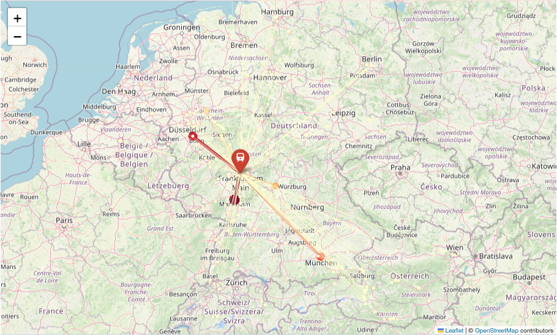
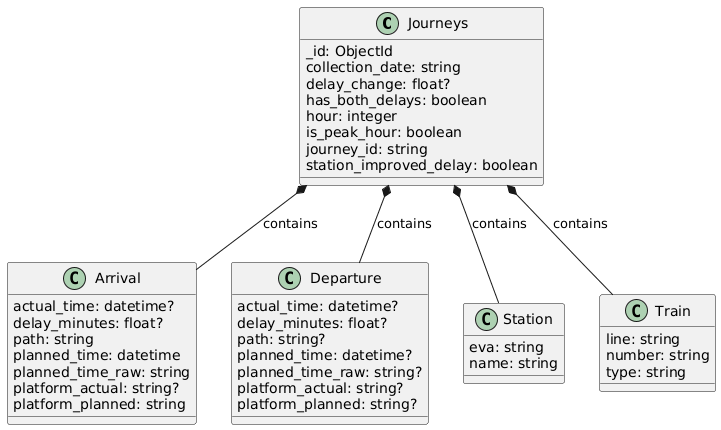

# Deutsche Bahn Delay Analysis

An ELT pipeline on the Deutsche Bahn Timetables API and MongoDB Atlas that collects real-time arrival and departure data for 20 major German stations and analyses where delays build up, where they are recovered, and how the long-distance network is connected.



## Problem
Delays in German long-distance rail are common, but station-level questions are hard to answer from public statistics: which stations add delay during stops and which recover it, which hubs the network depends on, and whether delays follow the daily traffic peaks. This project builds its own dataset from the live API to answer five research questions:

1. Which stations reduce or add delay during stops?
2. Which stations act as hubs, measured by unique connections?
3. How specialised are stations in train types (ICE, IC, EC)?
4. Which corridors matter most, and are they bidirectional or imbalanced?
5. Do delays increase during peak hours?

## Data
- **Source:** [DB API Marketplace, Timetables API v1](https://developers.deutschebahn.com/db-api-marketplace/apis/product/timetables): `/plan/{eva}/{date}/{hour}` for planned stops and `/fchg/{eva}` for actual times, delays and cancellations (XML).
- **Stations:** 20 main stations (Hbf), from Hamburg and Berlin to München and Stuttgart.
- **Period:** six collection days between 15 and 21 October 2025. The API only keeps about 12 hours of change history, so data was collected once a day in the evening.
- **Volume:** 14,743 planned train stops and 52,005 change records.
- Data is not included in this repository; it lived in a MongoDB Atlas cluster that is no longer maintained.

## Approach
- **Extract:** Python functions request plan and change data per station and hour and parse the XML with `ElementTree`.
- **Load:** raw documents go into MongoDB Atlas collections (`raw_timetable_plan`, `raw_timetable_changes`, plus a `collection_log`), with a unique index on station, date and hour.
- **Transform:** a 10+ stage MongoDB aggregation pipeline unwinds trains, joins plan and change data on journey, station and date, and derives delay minutes, delay change during a stop (departure minus arrival delay), recovery flags and peak-hour flags.
- **Analyse:** aggregations in MongoDB and pandas, visualised with matplotlib, seaborn and folium.



## Results
- **Delay recovery (RQ1):** Mannheim Hbf recovers delay during stops on average (−1.0 min, 40.3% of trains leave less delayed than they arrived); Erfurt Hbf adds the most (+1.3 min). Dortmund Hbf has the highest recovery rate at 48.2%.
- **Hubs (RQ2):** Frankfurt Hbf (203 unique connections), München Hbf (187) and Stuttgart Hbf (186) are the most connected stations.
- **Train types (RQ3):** ICE services make up more than 90% of departures at several major hubs; smaller stations have a more mixed IC/EC profile.
- **Corridors (RQ4):** corridors such as Karlsruhe ↔ Leipzig are stable in both directions, while end-of-line flows (e.g. Berlin → Berlin Ostbahnhof) are strongly asymmetric.
- **Peak hours (RQ5):** average delays rise through the evening peak to 17.2 min at 19:00 and peak at 20.9 min at 21:00, even though fewer trains run by then: delays from the evening peak carry over into the night.

The full analysis is in [`db_delay_analysis.ipynb`](db_delay_analysis.ipynb) and as a rendered report in [`docs/report.pdf`](docs/report.pdf).

## How to run
Requires Python 3.12, a MongoDB Atlas cluster and your own DB API credentials.

```bash
python -m venv .venv && source .venv/bin/activate
pip install -r requirements.txt
cp .env.example .env   # add MONGODB_URI, DB_CLIENT_ID, DB_API_KEY
jupyter lab db_delay_analysis.ipynb
```

1. Register an application for the Timetables API on the [DB API Marketplace](https://developers.deutschebahn.com/db-api-marketplace/apis/) to get a client ID and API key.
2. Run the extract and load sections once a day for several days; the API only provides recent change data.
3. Run the transform and analysis sections.

Note: the saved notebook outputs include a few `401 Unauthorized` responses in the live API test cells. These were produced when the report was rendered in November 2025, after the API credentials used for collection had expired. The analysis itself uses the data collected in October.

To re-render the PDF report: `quarto render db_delay_analysis.ipynb --to pdf` (requires Quarto and LuaLaTeX).

## Repository structure
```
├── db_delay_analysis.ipynb   # ELT pipeline and analysis
├── docs/                     # rendered report and figures
├── quarto/                   # LaTeX header and CSS for rendering
├── requirements.txt
└── .env.example              # required credentials
```

## Limitations & next steps
- Six days of data in one week of October; seasonal effects, weekends and disruptions are barely covered.
- Plan and change records are matched on journey ID; a spot check of 10 journeys matched 9, so some trains are likely missing from the joined data.
- Station-level results for stations with few matched trains (e.g. München Hbf with 55) are uncertain.
- The analysis is descriptive. Next steps: schedule the collection (e.g. a daily cloud job) for a longer period and model delay propagation between consecutive stations.
- Map coordinates for a few stations outside Germany were estimated rather than geocoded and are approximate.
